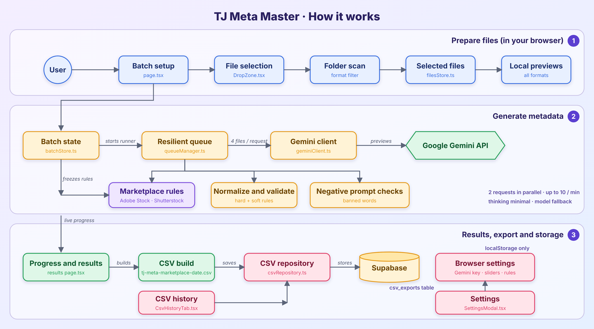

<div align="center">

# TJ Meta Master

**Bulk stock-metadata generator for Adobe Stock and Shutterstock.**
Drop in your files, pick one marketplace, set your limits, download a ready-to-upload CSV.

</div>

<p align="center">
  
</p>

---

## At a glance

| | |
|---|---|
| **Marketplaces** | Adobe Stock, Shutterstock (one per batch, rules never mixed) |
| **Formats** | JPG, JPEG, PNG, GIF, WebP, SVG, AI, EPS, MP4, MOV |
| **AI** | Google Gemini, using your own free key |
| **Privacy** | Originals never leave your computer; only small previews are sent |
| **Output** | One CSV per batch, named after the marketplace |

## Features

- **Bulk input.** Select files or a folder, or drag and drop. Folders are scanned recursively.
- **Marketplace-aware.** Each marketplace has its own prompt, validator, limits and CSV layout.
- **Local previews.** Built in the browser, so nothing is uploaded. See [Previews](#previews).
- **Adjustable output.** Sliders for title, description and keyword count, limited to what the selected marketplace really allows.
- **Negative Prompts.** Titles to avoid and words that must never appear.
- **Fast, resilient queue.** Parallel requests, automatic model fallback, pause and resume.
- **Results page.** Live progress, per-file retry, one-click CSV export.
- **CSV history.** Finished batches are saved to your account and can be downloaded, renamed or deleted.

## Marketplaces

| | Adobe Stock | Shutterstock |
|---|---|---|
| Title | Yes, up to 200 characters (slider) | No title field |
| Description | Not used (locked off) | Required, 50–500 characters (slider) |
| Keywords | 5–49 | 7–50 |
| Categories | Not requested | 2 per file, from Shutterstock's fixed list |
| CSV columns | `filename, title, description, keywords` | `filename, description, keywords, categories` |
| Title words | The first words of the title must also be the first keywords | n/a |

Sliders that a marketplace does not use are greyed out. Your saved slider values are never changed when you switch marketplace.

**Why the Shutterstock description stops at 500.** The CSV technically accepts 2048 characters, but Shutterstock recommends a short, natural sentence. 500 is a deliberate ceiling above that guidance, not a platform limit.

**Rules are strict or soft.**
- *Hard* (checked, the file is regenerated): minimum lengths, allowed characters, banned wording, unknown categories.
- *Soft* (retried once, then accepted): repeated words in a description, a missing category. Banned words are removed automatically instead of failing the file.

## How it works

1. Files are filtered and turned into small previews in the browser.
2. Previews go straight from the browser to the Gemini API with your own key. Nothing passes through Vercel or Supabase.
3. Each answer is parsed, normalized and checked against the marketplace rules.
4. The finished batch is written to Supabase as one CSV.

### Speed and queue

- **4 files per request**, **2 requests at the same time**, up to **10 requests per minute**.
- Gemini's "thinking" is set to the minimum. Metadata is a simple visual task, and thinking was the biggest source of delay.
- A per-minute limit makes the queue wait and retry. An overloaded model falls back to the next one. A bad key or finished daily quota pauses the batch so you can fix it and resume.
- A failing group is sent again as a whole first, then file by file, so one bad file cannot take the others down.

Tune the numbers in `src/lib/constants.ts` (`AI`) if Google changes its free-tier limits.

### Previews

| Format | How the preview is made |
|---|---|
| JPG, PNG, GIF, WebP | Decoded and resized in the browser |
| SVG | Drawn safely on a canvas (scripts do not run) |
| AI | Rendered with Ghostscript (WebAssembly) |
| EPS | Embedded preview when present, otherwise Ghostscript |
| MP4, MOV | Frames sampled at three points |

White margins around vector artwork are cropped so the model sees the real subject.

## Data and storage

| Where | What |
|---|---|
| Browser `localStorage` | Gemini key, slider values, selected marketplace, Negative Prompt entries |
| Supabase `csv_exports` | One row per finished CSV |
| Not stored anywhere | Your original files, previews, and the AI's raw answers |

`csv_exports` columns: `id` (uuid), `user_id` (uuid, owner), `kind` (`single` or `batch`), `file_name` (1–200 characters), `csv_content` (the CSV text, up to 5 MB) and a creation time. Row-level security keeps each user's rows private.

CSV files are named `tj-meta-<marketplace>-YYYY-MM-DD_hh-mm-ssAM.csv`.

## Negative Prompts

| Field | Limit | Purpose |
|---|---|---|
| Titles | up to 5 | Example titles whose style to avoid (locked for Shutterstock, which has no title) |
| Keywords | up to 30 | Words or phrases that must not appear anywhere in the result |

- Type a word or phrase and press comma then space to create a tag. Multi-word phrases stay together.
- Matching is by whole word and ignores case and punctuation: `tree` matches `Trees`, not `street`.
- A file that breaks a rule is regenerated on its own with the offending wording named. After the allowed attempts it is marked failed and can be retried.
- Rules are frozen when the batch starts, and empty rules change nothing.

## Limitations

- Free Gemini keys have per-minute and per-day quotas. Google applies them per project, so a replacement key should come from another project or account.
- Metadata quality depends on the preview. A very small or blank embedded EPS preview is re-rendered, which is slower.
- Adobe's own CSV page lists 70 characters for titles. If a very long title is trimmed on upload, lower the Title slider.
- Only one marketplace per batch.

## Tech stack

Next.js 15 (App Router), React 19, TypeScript, Tailwind CSS 4, Zustand, Zod, TanStack Virtual, Supabase (Auth and Postgres), Ghostscript WASM, Vitest.

## Getting started

Requires Node.js 20 or newer.

```bash
npm install
cp .env.example .env.local   # add your Supabase URL and anon key
npm run dev
```

Open http://localhost:3000. Prepare Supabase as described in [`supabase/README.md`](supabase/README.md), then each user adds their own Gemini key in **Settings → API Configuration**.

| Command | What it does |
|---|---|
| `npm run dev` | Development server |
| `npm run build` | Production build |
| `npm run typecheck` | TypeScript check |
| `npm test` | Unit tests |

## Project structure

```
src/
  app/                  Routes: login, home, results
  components/           UI
  features/
    ai/                 Gemini client, prompts, marketplace rules, rate limiter
    csv/                CSV building, download, history
    ingest/             File and folder scanning
    metadata/           Normalizer, validator, rule helpers
    negative/           Negative Prompt rules
    queue/              Batch runner
    thumbnail/          Image, SVG, AI, EPS and video previews
  lib/                  Constants, storage, Supabase clients
  store/                Zustand stores
  types/
supabase/               Migrations and setup guide
tests/                  Vitest suites
docs/                   README images
```

Adding a marketplace means writing its rules file in `src/features/ai/marketplaces/` and registering it in `index.ts`.

## Deployment

1. Import the repository into Vercel.
2. Set `NEXT_PUBLIC_SUPABASE_URL` and `NEXT_PUBLIC_SUPABASE_ANON_KEY`.
3. Deploy, then set the Supabase **Site URL** to your Vercel URL.
