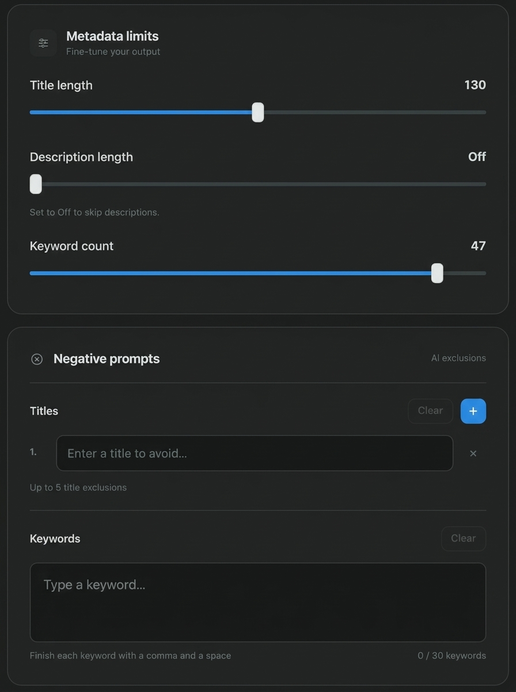

# TJ Meta Master

Generate SEO-ready titles, descriptions and keywords for stock images and videos, in bulk, straight from the browser.

Drop in a folder, pick a marketplace, set your limits and export a CSV. Original files never leave your machine: only small previews are sent to the Gemini API, and only the finished CSV is stored.

<p align="center">
  
</p>

## Features

- **Bulk input.** Select files or a whole folder, or drag and drop. Folders are scanned recursively.
- **Formats.** JPG, JPEG, PNG, GIF, EPS, MP4 and MOV.
- **Local previews.** Thumbnails are built in the browser with Web Workers. EPS files use their embedded preview or are rendered with Ghostscript (WebAssembly). Videos are sampled at three points.
- **Adjustable output.** Sliders for title length (60–200), description length (0–400, where 0 turns it off) and keyword count (10–50).
- **Negative Prompts.** Tell the generator which titles to avoid and which words must never appear. See [below](#negative-prompts).
- **Resilient queue.** Three files per request, paced to stay under the free-tier rate limit. Rate limits wait and retry, busy models fall back to the next one, and key or quota problems pause the batch so you can resume after fixing them.
- **Results page.** Virtualized list that stays smooth with large batches, live progress, per-file retry and one-click CSV export.
- **CSV history.** Every finished batch is saved to your account, and you can download, rename or delete it later.

## How it works

1. Files are filtered and turned into small JPEG previews in the browser. The originals are never uploaded.
2. Previews go directly from the browser to the Gemini API using your own key. Nothing passes through Vercel or Supabase.
3. Each answer is parsed, normalized and checked against your limits before it is accepted.
4. The finished batch is written to Supabase as one CSV row.

The Gemini key, slider values and Negative Prompt entries live in your browser's `localStorage`. The database holds only login accounts and the `csv_exports` table.

## Negative Prompts

Optional rules that shape what the generator is allowed to write. They sit under the sliders on the home page.

| Field | Limit | Purpose |
|---|---|---|
| Title | up to 5 | Example titles to steer away from. They describe a style to avoid, not a list of banned words. |
| Keywords | up to 30 | Words or phrases that must not appear in the title, description or keyword list. |

**Editing.** Every title row has a `×` to remove it (the last remaining row is cleared instead), and both the Title and Keywords sections have a **Clear** button that empties them at once. Clearing cannot be undone, and with everything cleared a batch runs as if the feature did not exist.

**Entering keywords.** Type a word or phrase and press comma then space. Everything before the comma becomes one tag, so multi-word phrases such as `santa claus` stay together. Backspace on an empty field removes the last tag.

**What happens during a batch**

- The rules are added to the marketplace instruction as quoted data, so the text you type cannot act as an instruction to the model.
- Every result is checked locally against whole words. `tree` matches `Tree`, `tree,` and `trees`, but not `street`. Case and punctuation differences do not get around a rule.
- A file that still breaks a rule is generated again on its own, with the offending wording named. The rest of its group of three is untouched.
- After three attempts the file is marked as failed and can be retried. A violation is never accepted silently and keywords are never quietly deleted.
- The rules are frozen when the batch starts, so editing the card mid-run does not affect it.

Leave both fields empty and the feature does nothing: the instruction and the requests are identical to a build without it.

Each retry is one more API request, so a long list of rarely avoidable words can slow a batch down on the free tier.

## Tech stack

Next.js 15 (App Router), React 19, TypeScript, Tailwind CSS 4, Zustand, Zod, TanStack Virtual, Supabase (Auth and Postgres), Ghostscript WASM, Vitest.

## Getting started

Requires Node.js 20 or newer.

```bash
npm install
cp .env.example .env.local   # add your Supabase URL and anon key
npm run dev
```

Then open http://localhost:3000.

Before the first run, prepare Supabase as described in [`supabase/README.md`](supabase/README.md): run the two files in `supabase/migrations/` in order, turn off public sign-ups and create your users. Each user adds their own Gemini API key in **Settings → API Configuration**.

## Scripts

| Command | What it does |
|---|---|
| `npm run dev` | Development server |
| `npm run build` | Production build |
| `npm start` | Run the production build |
| `npm run typecheck` | TypeScript check |
| `npm test` | Unit tests (Vitest) |

`dev` and `build` first run `scripts/prepare-assets.mjs`, which copies the Ghostscript files into `public/gs` and picks up `public/logo.*` and `public/brand-name.*`. To rebrand, replace those images and redeploy.

## Project structure

```
src/
  app/                  Routes: login, home, results
  components/           UI (home, results, settings, ui primitives)
  features/
    ai/                 Gemini client, prompts, marketplace rules, rate limiter
    csv/                CSV building, download and history
    ingest/             File and folder scanning, format filter
    metadata/           Normalizer and validator
    negative/           Negative Prompt rules, matching and prompt section
    queue/              Batch runner (grouping, retries, pausing)
    thumbnail/          Image, video and EPS previews (Web Workers)
  lib/                  Constants, storage, Supabase clients
  store/                Zustand stores
  types/
supabase/               Migrations and setup guide
tests/                  Vitest suites
```

Adding a marketplace means writing its rules file in `src/features/ai/marketplaces/` and registering it in `index.ts`.

## Deployment

1. Import the repository into Vercel.
2. Set `NEXT_PUBLIC_SUPABASE_URL` and `NEXT_PUBLIC_SUPABASE_ANON_KEY`.
3. Deploy, then set the Supabase **Site URL** to your Vercel URL.

## Notes

- Gemini model names and the free-tier pacing are defined in `src/lib/constants.ts` (`AI`). Review them when Google changes its lineup.
- Google applies rate limits per project, not per key, so a replacement key should come from a different project or account.
- An EPS with a missing or very small embedded preview is rendered with Ghostscript instead, which is slower.
